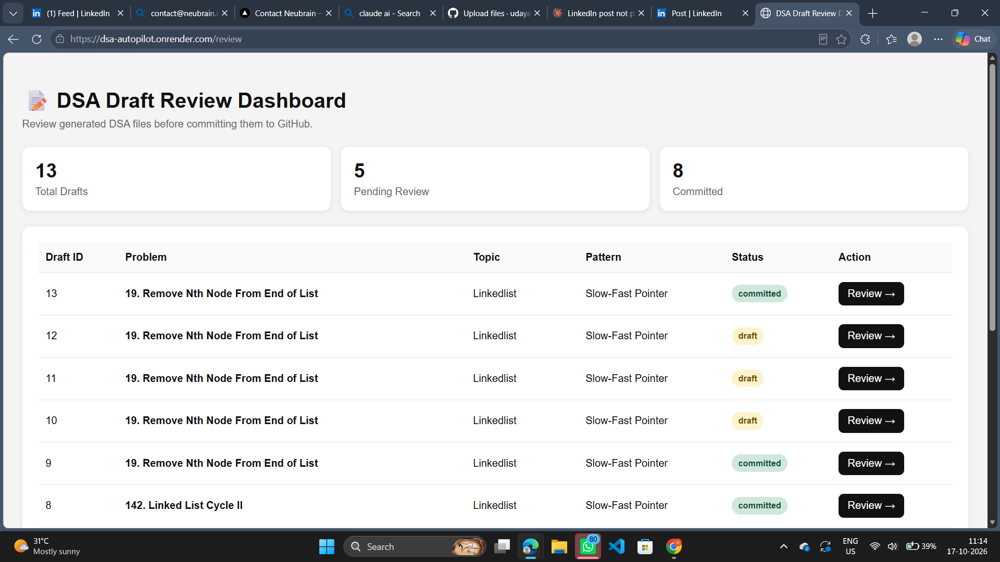
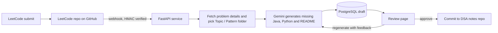

# DSA Autopilot 🤖

**AI-Powered DSA Notes Automation System**

A FastAPI service that turns your LeetCode submissions into organised DSA notes. Solve a problem, and Java/Python solutions plus a README are generated with AI, saved as a draft for your review, and committed to your notes repo only after you approve.

## 🚀 Live Demo
[Click here to view the live service](https://dsa-autopilot.onrender.com)

The review page is password protected, because approving a draft writes to my GitHub.

## 🎬 Demo Video

https://github.com/user-attachments/assets/ee6c7a56-9e95-4bd9-9cac-f241c96b6396

The live review page asks for a password before it opens. Watch the demo above to see the full workflow without signing in.

## 📸 Screenshots
**Review dashboard:** all generated drafts with their status


## 🛠️ Tech Stack
- **FastAPI** - webhook receiver and review dashboard
- **GitHub Webhooks + REST API** - detect new solutions and commit approved notes
- **Google Gemini (google-genai)** - generates solutions and README notes
- **PostgreSQL + SQLAlchemy** - stores drafts
- **Docker + Render** - deployment
- **pytest** - tests

## 📁 Project Structure
- `app/main.py` - app setup, security middleware, health check
- `app/routers/github_webhook.py` - webhook endpoint and generation pipeline
- `app/routers/review.py` - review page, regenerate and approve
- `app/services/` - GitHub, LeetCode, classifier, Gemini services
- `app/models/draft.py` - draft database model
- `app/security.py` - password protection and lockout
- `watcher.py` - optional laptop script that opens the review page automatically
- `tests/` - pytest tests

## ⚙️ How it works


1. I submit a solution on LeetCode, and it is pushed to my LeetCode repo on GitHub
2. GitHub sends a webhook, and the signature is verified (HMAC-SHA256)
3. The app fetches the problem details and picks the right Topic / Pattern folder from my existing notes repo
4. Gemini generates only the missing files (Java, Python, README)
5. The draft is saved in PostgreSQL and shown on the password-protected review page
6. I review the draft, optionally regenerate with feedback, and approve
7. On approval, the files are committed to my DSA notes repo in one commit

## 🏃 Run Locally
```bash
pip install -r requirements-dev.txt
cp .env.example .env
uvicorn app.main:app --reload
pytest
```

## 🔑 Environment Variables
Create a `.env` file with:
```
DATABASE_URL=your_postgres_url
GITHUB_TOKEN=your_token
GITHUB_OWNER=your_github_username
LEETCODE_REPO=your_leetcode_repo
DSA_REPO=your_notes_repo
GITHUB_WEBHOOK_SECRET=your_secret
GEMINI_API_KEY=your_key
REVIEW_USERNAME=your_username
REVIEW_PASSWORD=your_password
PUBLIC_BASE_URL=https://your-app.onrender.com
```
