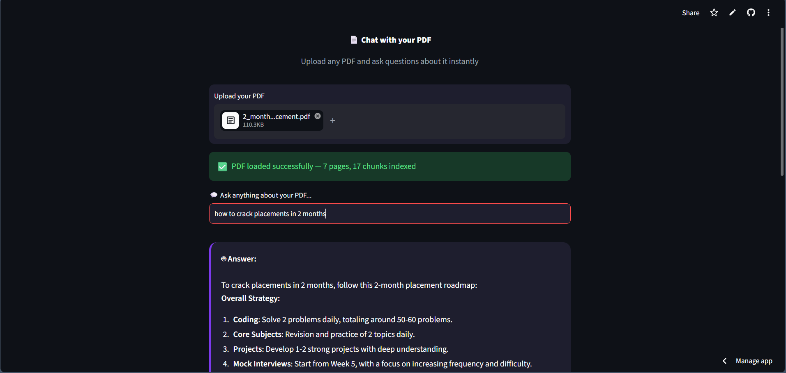
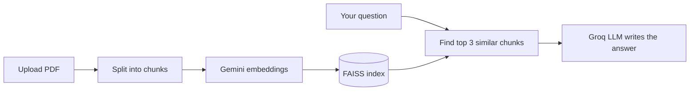

# Chat with PDF 📄

An AI-powered app that lets you upload any PDF and ask questions about it instantly, using Retrieval-Augmented Generation (RAG).

## 🚀 Live Demo
[Click here to try it live](https://gen-ai-projects-caxfmgw7xzfg6jfbwqqlz7.streamlit.app/)



## 🛠️ Tech Stack
- **LangChain** - PDF loading (PyPDFLoader) and text splitting
- **Google Gemini** - text embeddings (gemini-embedding-001)
- **FAISS** - in-memory vector similarity search
- **Groq (openai/gpt-oss-120b)** - fast answer generation
- **Streamlit** - web interface

## 📁 Project Structure
- `streamlit_app.py` - Streamlit UI plus the RAG pipeline used by the live app
- `app.py` - simple command-line version of the same pipeline for quick testing (set your own PDF path inside)
- `requirements.txt` - dependencies

## ⚙️ How it works


1. Upload any PDF file
2. The app splits the PDF into chunks and creates embeddings
3. Your question is matched against the most relevant chunks using FAISS
4. The Groq LLM generates an accurate answer from those chunks

## 🏃 Run Locally
```bash
pip install -r requirements.txt
streamlit run streamlit_app.py
```

## 🔑 Environment Variables
Create a `.env` file with:
```
GOOGLE_API_KEY=your_key
GROQ_API_KEY=your_key
```
